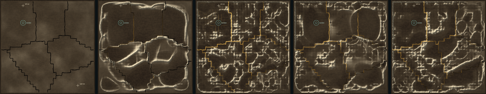

# Resonating Matter

**A cracked plate that sound can mend.** Play it a song. Sand hops off the places that shake and gathers where they don't (Chladni). Gold grows across the cracks that the song works hardest (Kerrostuma's traffic-becomes-conductance rule). Both change how the plate rings, and what you hear is the plate's own vibration — the same numbers that move the sand.

Open `index.html` (GitHub Pages, or any local web server; it also tries to run straight from disk).



*Same seed, five pasts, rendered by the page's own shader. Left to right: the original plate; 90 s of the low hymn; the same tune two octaves up; a C-major tune; the same tune in F♯. The low hymn carves wide loops and barely gilds anything. The high tune gilds most seams near the speaker.*

Ethic: do not hype, do not lie, just show. This is a working instrument and a measured experiment. It is not a song recognizer, and the plate does not learn to sing back.

---

## What you can do on the page

- **Grow**: play the low hymn, the bright bells, your own file, or the microphone into the speaker under the first tile.
- **Play**: click to strike. The left ear sits in the speaker's tile, the right ear on the farthest tile. On a fresh plate the right ear hears almost nothing; as gold grows the far tiles wake up.
- **Intervene**: cut gold, rake sand, move the speaker or the ears. Each changes the sound, because each changes the body.
- **Compare two pasts**: keep the plate as A, grow on something else, keep as B, then *Compare* strikes A, B and the original with the identical hit, frozen, and shows their spectra and how loud the far ear is.
- **The plate's notes**: compiles the current plate into its 1024 vibration modes (Moon's lesson: bake the slow part once, keep the fast part cheap) and draws the lowest 16 as Chladni figures. Click one to drive the speaker at that note and watch the sand go to its nodal lines.
- **Keep it**: save the plate (its sand, gold, speaker and ears, not the song). Anyone can load it and play it.
- **Layer audit**: four switches. Turn a mechanism off and see what stops.

## How it works (from the code, `src/engine.js`)

| Layer | What it is | Reads | Writes |
|---|---|---|---|
| Body | Clamped 32×32 membrane, time-stepped at 24 000 steps/s (symplectic Euler) in the AudioWorklet | mass, damping, link stiffness | velocity → the two ears (sound out) |
| Cracks | Seeded Voronoi tiles; links that cross a tile boundary start at 6% stiffness | — | base stiffness |
| Sand | 128×128 field; grains hop where local acceleration power beats a threshold (`ds/dt = ∇²(D s)`) | acceleration covariances of the body | mass (`m = 1 + 2·S`) and friction |
| Gold | One value per link; grows where shear acceleration across the link is sustained and sand is present (Kerrostuma's rule, re-sourced) | link shear, sand | link stiffness (`k = kbase + 0.2·g`) |
| Ears | velocity at two nodes, interpolated to the sound card rate | body | speakers |

The fine sand field reads the exact power of the bilinearly interpolated vibration, from accumulated node covariances, so the Chladni lines are four times finer than the body's grid without being painted.

The song enters as a force at the speaker after a slow AGC and a ~1.2 kHz low-pass (a 32-node body cannot represent much above ~2 kHz). This is the honest limit of the instrument: it hears pitch and timing, not words or timbre.

### Pieces reused, read from their code

- **World** (Astra): the idea that a force field writes persistent matter that changes later forces, and its test style (freeze, kill, determinism). Not its shaders: World's oscillators are a seeded lattice, not a body with modes, which is why WorldAsResonator could only change gain.
- **WorldAsResonator**: the grow/freeze/listen 2×2 design and its scoring (remove "this world is louder" and "this song is louder", then look at the diagonal), rerun here on a body that really vibrates.
- **Kerrostuma** (`core.js`): sustained traffic through a path turns into gel that conducts. Here "traffic" is shear vibration across a crack, and "conducts" is stiffness.
- **Moon**: split slow from fast. Moon bakes lighting into textures when the sun moves; here the compile bakes the plate into modes when the matter changes, and each mode is then a two-line recursion. The time stepper's pitch is reproduced exactly (`cos θ = 1 − λ/2`); the measured error is damping that is not mode-shaped.

---

## Honest ledger

### Routed (each one checked by switching it off, `tests/core.test.js`)

- Sound moves sand, sand changes sound. With "sand weighs" off, swapping two plates' sand leaves a strike bit-identical; with it on, the strike changes (relative difference 1.24).
- Sound grows gold, gold changes sound. Same test for gold: identical when off, 1.39 when on.
- Freeze: 10 s of loud song into a frozen plate leaves every grain and every thread of gold bit-identical. A silent plate does the same.
- Sand is conserved while moving (relative error 1.6e-8).
- Same seed + same song → bit-identical plate. Different song → different plate.
- Restoring the original matter restores the original sound exactly.
- The engine in `index.html` is byte-identical to the tested `src/engine.js` (the tests load it from `index.html`).

All 16 core checks pass: `results/core.json`.

### Still painted or hand-set

- The crack map is a seeded Voronoi, not grown. Gold only mends; nothing new cracks.
- Rendering choices: bronze brushing, sand grain sparkle, the slight wobble of the seams, and the teal glow (normalized to the current loudest point, so it shows *where*, not *how much*).
- All thresholds and rates were tuned by hand on one seed and one song before the experiments, then frozen (engine sha1 `2d336f9d74ab`).
- Strikes are real vibrations and can nudge sand near where you hit.

### Bridge cut (one seed, `core.test.js`)

After 60 s of the high tune, cutting the 30 gilded crack links around the speaker's tile dropped the far ear by **4.7 dB** for the same strike. A control cut of 30 gilded crack links elsewhere dropped it by **1.0 dB**. The original ungilded plate is **11.7 dB** quieter at the far ear. Caveat: the control links held less gold in total (9.2 vs 16.3), so this is not a matched-gold control.

### Compile fidelity

The compiled voice (all 1024 modes) matches the time-stepped strike to **2.8% RMS error** on a grown plate. Truncating to the lowest 256 modes gives 35% error for a sharp strike, so the page always uses all of them for sound and shows only 16. Compile time here was 12 s in Node and 33 s in headless Chrome on two contended cores; not measured on an RTX 3060 machine (it runs on the CPU either way).

### The tuning experiment (the question we came for)

*Does a plate grown on a song become a resonator for that song?* Five seeds; per seed, eight plates grown 90 s each from the same starting plate on eight synthetic songs in four pairs (register, key, rhythm, order); then every song is played into every frozen plate and the output power at the ears measured (`tests/experiment.js`, `tests/analyze.js`, `results/tuning_summary.json`).

**No. It does the opposite.** Every seed's diagonal is negative: plates ring less for the song that grew them (mean −0.21 log units, about 19% weaker; 5/5 seeds, sign test p = 0.03 one-sided; per-seed permutation p from 0.0005 to 0.30). Picking the loudest plate for a song finds its own plate 0–2 times out of 8, which is chance.

Per pair, using the contrast `log(R_aa·R_bb / R_ab·R_ba)`, which cancels both plate gain and song loudness:

| Pair (what differs) | Contrast per seed (1, 2026, 2718, 42, 7) | Direction |
|---|---|---|
| Key (C vs F♯, same register) | −2.58, −0.84, −0.68, −4.50, −1.18 | own song weaker, 5/5 |
| Register (low vs high) | +0.55, −1.31, −0.16, +1.27, −1.62 | mixed |
| Rhythm (same notes, straight vs broken) | +0.29, +0.63, +0.31, +0.02, +0.02 | own song stronger, 5/5, small |
| Order (same notes, up vs down) | −0.06, −0.02, +0.01, +0.01, −0.03 | none |

So the plate **detunes itself away from the pitches it heard**. In the earlier conversation the hypothesis was the reverse: sand gathers on the played modes' nodal lines, where it can't hurt them, and the plate "protects the songs it heard". The measurement says otherwise. The likely reason, not yet tested directly: sand *leaving* the antinodes of the played modes lightens them, which raises their pitch, away from the song; gold stiffens worked links, which also raises pitch. Swapping one material at a time between the C and F♯ plates, both sand alone and gold alone reproduce the negative contrast on 5/5 seeds (`results/control_*.json`; sand alone −0.5 to −2.6, gold alone −0.2 to −1.8).

This is the same sign WorldAsResonator found (habituation), now in a body with real modes and much larger: a whole-key effect, not a 1% one.

### What the plates do remember

- Different pasts sound different under the identical strike: plates grown on the low vs high tune differ by **6.6–8.0 dB** (RMS over 48 bands), C vs F♯ by **3.3–5.9 dB**, and every grown plate differs from the original by 7.9–13.8 dB.
- **Order is not shown to be stored.** Up vs down (same notes) differs by 2.7–4.6 dB, but the *same* song started 0.125 s late differs by 1.8–4.1 dB. The order difference is within the plate's sensitivity to timing.
- How much a song gilds is lawful and repeatable: the high tune mends 30–32% of crack gold on every seed, the low hymn 7–13%.

### Limits

Synthetic eight-note songs, 90 s of growth, total output power as the only response measure, one body size, CPU only. Real music (Gospel of Snoop) has not been put through the experiment; the page will grow a plate from it, but nothing is measured there. Not tested on the RTX 3060 machine; the audio engine ran at real time in headless Chrome on two shared cores here.

### Open next steps (untested)

- Test the detuning explanation directly: compile the plate before and after growth and track the frequency of the modes the song drives hardest.
- If the detuning holds, it is a usable mechanism: a plate that becomes *deaf* to what it has heard is a novelty detector. Score it as one: does a grown plate ring more for a new key than for the one it grew on, on held-out songs?
- Make sand gather at antinodes (the fine-powder regime) and see if the sign flips.

## Run the tests

```
node tests/core.test.js              # 16 checks, ~2 min
node tests/experiment.js 2718 90 6   # one seed of the tuning experiment, ~8 min
node tests/control.js 2718           # timing control + sand/gold swap (needs the seed's experiment first)
node tests/analyze.js                # pools results/tuning_*.json
node tools/build.js                  # rebuild index.html from src/
```

`results/grown_2718.json` holds the eight grown plates for seed 2718; other seeds regenerate bit-identically with `experiment.js`.

Built by Claude (Opus 5.5) for anttiluode, November 2026, from World (Astra), WorldAsResonator, Kerrostuma and Moon.
